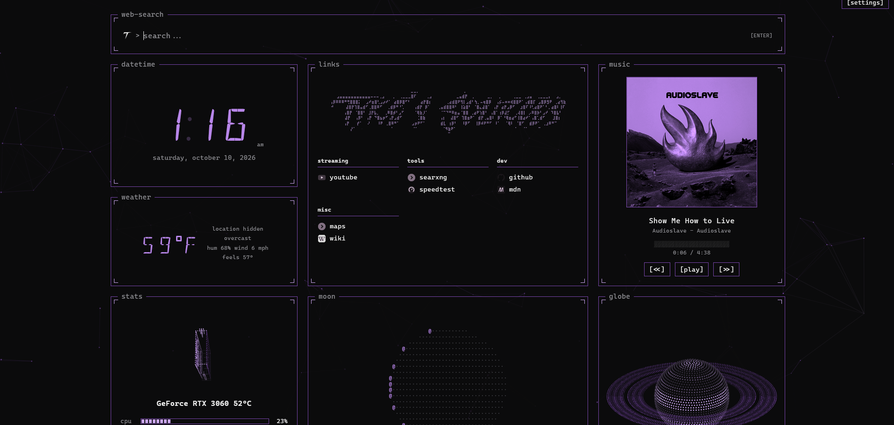

# Tyke's Startpage

A self-hosted browser start page with a dotted, animated look: web search, your links, a live clock, weather, moon phase, a spinning globe, live system stats with a spinning RTX 3060, and Windows now-playing music controls with a visualizer.



## Features

- **Search bar** for SearXNG or Google. Click the logo to switch engine. Searches open in a new tab.
- **Links** in groups you edit as plain text. Links open in a new tab, and you can set your own logo per link (right-click, or long-press on touch).
- **Clock, weather, moon phase** with 12/24-hour time and °C/°F. Weather uses [Open-Meteo](https://open-meteo.com), no API key needed.
- **Globe** you can drag and spin: earth, solar system, Saturn, or a black hole. Double-click it to switch.
- **Live stats**: CPU, RAM, and (NVIDIA only) GPU load, VRAM, name and temperature, shown with a spinning dotted graphics card whose fans speed up with GPU load.
- **Music panel** with now playing, album art, play/pause/next/previous and an audio visualizer (Windows only).
- **Accent colors** (including rainbow) that recolor the whole page.
- Settings are saved in your browser, not on the server.

---

## Install on Windows (recommended)

This is the easiest way, and the only way to get the **music controls and visualizer**. No coding knowledge needed. Just follow the steps in order.

### Step 1: Install Python

Python is the free program that runs the start page.

1. Go to <https://www.python.org/downloads/> and click the big yellow **Download Python** button.
2. Open the file you downloaded (it's called something like `python-3.x.x-amd64.exe`).
3. **Important:** on the very first screen of the installer, tick the box at the bottom that says **"Add python.exe to PATH"**. If you miss this, the start page may not launch.
4. Click **Install Now**, then click **Yes** if Windows asks for permission.
5. When it says "Setup was successful", click **Close**.

### Step 2: Download the start page

1. Go to <https://github.com/txkex/Tykes-Startpage>.
2. Click the green **Code** button near the top right of the file list, then click **Download ZIP**.
3. Open your **Downloads** folder, right-click the ZIP file (`Tykes-Startpage-main.zip`) and choose **Extract All...**, then click **Extract**.
4. Move the extracted folder somewhere permanent, like `Documents` or `C:\Startpage`. Don't leave it in Downloads, because if you delete it later the start page stops working.

> Don't run it from inside the ZIP. It has to be extracted first or it won't work.

### Step 3: Start it

1. Open the extracted folder. You should see files like `startpage.pyw`, `server.py` and `startpage.html`.
2. **Double-click `startpage.pyw`.**
3. Wait about 1 to 2 minutes the first time. No window will appear. It's quietly downloading the extra pieces it needs (stats, tray icon, music support). This only happens once.
4. Look at the bottom-right of your screen near the clock. Click the **^** arrow to show hidden icons. A small start page icon will appear when it's ready.

> If Windows shows a blue "Windows protected your PC" box, click **More info**, then **Run anyway**. This happens with any program that isn't from a big publisher.

### Step 4: Open the page

Open your web browser (Chrome, Edge, Firefox, anything) and go to:

**<http://localhost:8787>**

That's it! You should see the start page. You can also right-click the tray icon and click **Open start page**.

### Step 5: Make it your browser's home page (optional)

So it opens every time you start your browser:

- **Chrome:** Settings > *On startup* > *Open a specific page* > *Add a new page* > paste `http://localhost:8787`. Also turn on *Show home button* under *Appearance* and set it to the same address.
- **Edge:** Settings > *Start, home, and new tabs* > *Open these pages* > *Add a new page* > paste `http://localhost:8787`.
- **Firefox:** Settings > *Home* > *Homepage and new windows* > *Custom URLs...* > paste `http://localhost:8787`. Or use the [Firefox extension](#firefox-extension-optional) below, which also opens it on every new tab without showing the address.

### Step 6: Make it start with Windows (optional)

The start page only works while it's running. To have it start by itself when you turn on your PC:

1. Click the **^** arrow near your clock and right-click the start page icon.
2. Click **Start with Windows**. A tick appears next to it when it's on.

### The tray icon menu

Right-click the tray icon for:

- **Previous track / Play / pause / Next track**: control whatever music is playing
- **Open start page**: opens the page in your browser
- **View raw stats**: shows the raw CPU, RAM and GPU numbers
- **Start with Windows**: turns auto-start on or off
- **Quit**: stops the start page

### Updating

1. Right-click the tray icon and click **Quit**.
2. Download the new ZIP from <https://github.com/txkex/Tykes-Startpage> the same way as Step 2 and extract it.
3. Copy your `config.json` (if you made one) into the new folder, then double-click `startpage.pyw` again.

> Your links, colors and other settings are saved in your browser, so they stay when you update.

### Troubleshooting (Windows)

| Problem | Fix |
| --- | --- |
| Nothing happens when I double-click `startpage.pyw` | Python probably isn't installed with PATH ticked. Re-run the Python installer, choose **Modify** or **Repair**, and make sure **Add python.exe to PATH** is ticked. |
| Double-clicking opens Notepad or asks which app to use | Python isn't installed. Do Step 1. |
| The page says it can't connect | Wait a minute or two on the first launch, then refresh. Check the tray icon is there (click **^** by the clock). |
| No music info or visualizer | Start playing something in Spotify, a browser, or another media app. The visualizer listens to whatever your speakers are playing. |
| No GPU stats | GPU stats only work with NVIDIA graphics cards. CPU and RAM always work. |
| "Could not listen" / port already in use | The start page is probably already running (check the tray icon). Otherwise change the `port` in `config.json` (see below). |
| Anything else | Open `stats_server.log` in the start page folder. Errors are written there. |

---

## Firefox extension (optional)

`tyke-startpage.xpi` (in the project folder) is a small Firefox extension that makes the start page your **new tab page**. Every new tab shows the start page, the address bar stays blank (no `localhost:8787` or server IP in it), and a toolbar button opens a new tab with the page on demand.

The extension only shows the page, it doesn't run it. The start page still has to be running (the Windows tray app, or Docker), or new tabs will come up empty.

### Install the extension

The `.xpi` isn't signed by Mozilla, so normal Firefox won't keep it installed unless you use one of these:

- **Firefox Developer Edition, Nightly, ESR or Unbranded:** open `about:config`, search for `xpinstall.signatures.required` and set it to `false`. Then open `about:addons`, click the gear icon, choose **Install Add-on From File...** and pick `tyke-startpage.xpi`. (Regular Firefox and Beta ignore this setting.)
- **Any Firefox, temporarily:** open `about:debugging#/runtime/this-firefox`, click **Load Temporary Add-on...** and pick `tyke-startpage.xpi`. It's removed when you close Firefox, so you'd have to repeat this each time.
- **Any Firefox, permanently:** sign the file for free at [addons.mozilla.org](https://addons.mozilla.org/developers/) by submitting it as **On your own** (unlisted), then install the signed file you get back.

### Set the start page address

The extension opens `http://tyke.start:8787` by default, which only works if you've set up that name (see *Using a custom address* below). To change it:

1. Open `about:addons` and click **Tyke Start Page**, then **Preferences**.
2. Type the address of your start page, for example `http://localhost:8787`, and click **Save**.

If you want to reach the page from other devices over Tailscale, use the machine's Tailscale address (for example `http://100.x.y.z:8787`) and set `"host": "0.0.0.0"` in `config.json` so the server listens on it. Leave the box empty and save to go back to the default.

To remove the extension, open `about:addons` and click **Remove** next to it.

---

## Settings

Click **[settings]** in the top right of the page to change the search engine, weather city, units, colors, time format, globe, and your list of links. In the links box, `# name` starts a group and each following line is `name url`.

For example:

```
# streaming
youtube https://youtube.com

# tools
searxng https://your-searxng-address
speedtest https://speedtest.net
```

### Server options (optional)

Most people never need these. To use them, make a file called `config.json` in the same folder as `server.py` (the easiest way is to copy `config_example.json` and rename the copy to `config.json`). Open it in Notepad to edit. You can also use environment variables.

| Option | Default | What it does |
| --- | --- | --- |
| `host` | `127.0.0.1` (Docker: `0.0.0.0`) | Address to listen on |
| `port` | `8787` | Port to listen on |
| `open_url` | `http://localhost:<port>` | Address the tray's "Open start page" opens, e.g. `http://tyke.start` |
| `cors_origin` | none | A page address allowed to use this server from another host, for when the page runs on a NAS but the music helper runs on your desktop |

### Using a custom address like `http://tyke.start`

Add a line to your hosts file pointing the name at the machine running the page, then open `http://tyke.start`:

```
127.0.0.1 tyke.start
```

On Windows:

1. Press the Start button, type **Notepad**, right-click it and choose **Run as administrator**.
2. In Notepad go to **File > Open**, paste `C:\Windows\System32\drivers\etc` into the address bar and press Enter.
3. Change the file type dropdown (bottom right) from *Text Documents* to **All Files**, then open the file named `hosts`.
4. Add the line above at the bottom, then save.

Note that `http://tyke.start` (with no port number) only works if the page is served on port 80, which the Docker setup below does. On the Windows version, set `"port": 80` in `config.json` or just use `http://tyke.start:8787`.

Use your server's IP instead of `127.0.0.1` if the page runs on another machine.

---

## Install with Docker (alternative)

Use this if you want to run the start page on a NAS, home server, or always-on machine. **Docker can show CPU, RAM and (optionally) GPU stats, but not music controls or the visualizer**, because a container can't see your desktop's media session. If you want music, use the Windows install above.

1. Install [Docker Desktop](https://www.docker.com/products/docker-desktop/) (Windows/Mac) or Docker Engine (Linux) and make sure it's running.
2. Install [Git](https://git-scm.com/downloads), or just download the ZIP from GitHub like in Windows Step 2.
3. Open a terminal (PowerShell on Windows) in the folder where you want it and run:

```
git clone https://github.com/txkex/Tykes-Startpage.git
cd Tykes-Startpage
docker compose up -d --build
```

4. Open <http://localhost:8787>.

Notes:

- The compose file also publishes port 80, so you can open the page without a port number. Delete that line in `docker-compose.yml` if port 80 is already in use on your machine.
- **NVIDIA GPU stats:** install the NVIDIA Container Toolkit on the host and uncomment the GPU lines in `docker-compose.yml`.
- Keep Docker stats and Windows music together by running the page on your NAS and the Windows helper on your desktop. Set `cors_origin` (see Server options above) to the NAS page address.
- To stop it: `docker compose down`. To update: `git pull` then `docker compose up -d --build`.

---

## Server endpoints

| Path | What it returns |
| --- | --- |
| `/` | The start page |
| `/stats` | CPU, RAM and GPU as JSON |
| `/media` | Now playing: title, artist, album art (Windows) |
| `/media/<prev\|play_pause\|next>` | POST to control playback (Windows) |
| `/spectrum` | Live audio bands for the visualizer (Windows) |

## Notes

- Link icons are fetched from DuckDuckGo's icon service, and weather from Open-Meteo, so those two features need internet access.
- The server only accepts requests from its own page (and `cors_origin` if set), so other websites can't press your media buttons.

## License

Released under the [MIT License](LICENSE).
